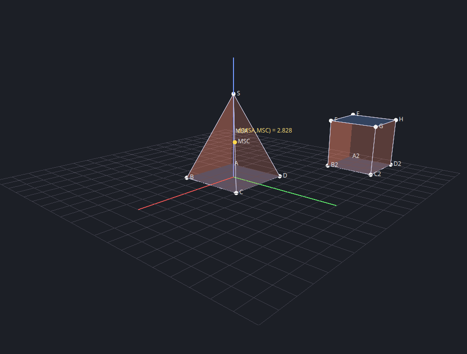

# GeoSpace 3D

Phần mềm hỗ trợ giảng dạy **hình học không gian 3D cấp THPT**, viết bằng **Python + PyQt6 + PyOpenGL**.
Người dùng không lập trình từng hình: chỉ khai báo **điểm** và **quan hệ hình học**, phần mềm tự dựng mô hình 3D và tự cập nhật khi tham số thay đổi.



---

## 1. Cài đặt & chạy

```bash
cd GeoSpace3D
pip install -r requirements.txt
python3 main.py
```

Chạy test lõi hình học (không cần màn hình):

```bash
python3 -m pytest tests/ -q
```

Yêu cầu: Python 3.10+, PyQt6, PyOpenGL, numpy. Khuyến nghị có GPU/OpenGL ≥ 2.1 (dùng compatibility profile + immediate mode để code gọn).

---

## 2. Tính năng

| Nhóm | Nội dung |
|---|---|
| Không gian 3D | Trục Oxyz + lưới, camera orbit **360°**, zoom, pan, phóng to/thu nhỏ, phối cảnh / song song |
| Điểm | Điểm tự do (toạ độ), **trung điểm**, **chia đoạn m:n**, **điểm đối xứng**, **điểm chạy trên cạnh** (kéo `t`) |
| Đường & mặt | Đoạn thẳng, đường thẳng, mặt phẳng/đa giác (tô màu, alpha) |
| Khối | Lập phương, hộp chữ nhật, hình chóp, lăng trụ tam giác, **trụ, nón, cầu** |
| Quan hệ | Đồ thị phụ thuộc: sửa A ⇒ trung điểm, cạnh, mặt, khối tự cập nhật |
| Layer | Cây đối tượng theo nhóm, ẩn/hiện, đổi tên, đổi màu, độ trong suốt, xoá (cascade) |
| Đo đạc | Khoảng cách 2 điểm, góc 3 điểm |
| Hiển thị | **Đường khuất nét đứt**, nhãn tên điểm, highlight điểm đang chọn |
| Khác | Undo/Redo, auto-rotate, animation điểm chạy trên cạnh, xuất PNG, lưu/mở `.json` |

---

## 3. Thao tác

| Chuột / phím | Chức năng |
|---|---|
| Click điểm | Chọn điểm (đồng bộ với cây Layer) |
| Lăn chuột | Tăng/giảm tốc độ di chuyển |
| Chuột phải kéo | Di chuyển ngang/dọc |
| `W` / `S` | Tiến / Lùi |
| `A` / `D` | Sang trái / Sang phải |
| `Space` / `Ctrl` | Lên / Xuống |
| `Shift` | Chạy nhanh (giữ) |
| `Home` | Về vị trí & góc nhìn mặc định |
| `1` / `2` / `3` | Nhìn từ trước / trên / phải |
| `5` | Bật/tắt phối cảnh song song (ortho) |
| `Ctrl+Z` / `Ctrl+Y` | Undo / Redo |
| `Ctrl+N` / `Ctrl+O` / `Ctrl+S` | New / Open / Save |

Nút **Sample** tạo nhanh bài mẫu: chóp `S.ABCD` + `M`, `N` là trung điểm `SA`, `SC` + đoạn `MN` + số đo `MN`.

---

## 4. Kiến trúc (A + B)

```
GUI (PyQt6)  ──  Viewport (PyOpenGL)  ──  Scene (DAG)  ──  Generators
   toolbar          camera, vẽ            objects +        macro sinh
   layer            Oxyz, nhãn            phụ thuộc        Point/Face/Solid
```

**Nguyên tắc:** renderer không tính toán hình học; `core/` không import Qt/OpenGL.

Mọi hình đều là tập hợp đối tượng cơ bản. Ví dụ hình lập phương chỉ cần 4 đỉnh tự do, 4 đỉnh còn lại là **tổ hợp tuyến tính**:

```
C = B − A + D      F = B − A + E
G = C − A + E      H = D − A + E
```

`affine(Σ cᵢ·Pᵢ)` cũng chính là công thức của trung điểm `0.5A+0.5B`, chia đoạn `⅔A+⅓B`, đối xứng `2O−A`. Vì vậy **không có hàm vẽ riêng cho từng hình** — chỉ có một từ vựng constructor nhỏ.

Thay đổi một điểm ⇒ lan truyền theo DAG ⇒ tính lại theo thứ tự topo ⇒ chỉ vẽ lại scene. Lưu file chỉ lưu **quan hệ**, không lưu toạ độ kết quả, nên mở lại vẫn đúng bản chất hình học.

### Cấu trúc

```
main.py                 khởi tạo QApplication + QSurfaceFormat
core/math3d.py          vector, pháp tuyến, góc, chiếu màn hình
core/scene.py           Obj, Scene, DAG, undo/redo, save/load, mặt cong
core/generators.py      gen_cube / box / pyramid / prism / cylinder / cone / sphere
                        gen_midpoint / divide / symmetric / on_segment / distance / angle
gui/viewport.py         camera orbit, Oxyz, vẽ, đường khuất, nhãn, click chọn
gui/main_window.py      toolbar, cây Layer, panel thuộc tính, animation, file
gui/dialogs.py          hộp thoại nhập điểm / tạo khối
tests/test_core.py      11 test cho lõi hình học
```

---

## 5. Định dạng file

`*.json` — danh sách đối tượng, mỗi đối tượng có `id`, `kind`, `name`, `ctor`, `args`, `color`, `visible`.
`args` chứa **id** của các đối tượng phụ thuộc, không chứa toạ độ đã tính.

---

## 6. Hạn chế & hướng phát triển

Đã cắt bớt để phù hợp phạm vi bài tập nhóm (xem `PLAN_FULL.md`):

- Chưa có parser ngôn ngữ lệnh (hiện dùng hộp thoại) — bản đầy đủ dự kiến thêm console.
- Chưa có thiết diện, góc nhị diện, thể tích, explode view, xuất PDF/OBJ.
- Chưa đóng gói `.exe` (chạy trực tiếp bằng Python).
- Renderer dùng immediate mode; kiến trúc đã tách core/renderer nên có thể chuyển sang VBO + shader (Core Profile) mà không sửa `core/`.
- Mặt cong hiển thị dạng wireframe + mặt trong suốt xấp xỉ, chưa khép kín khối.
